---
## Author
author:
  name: Стрижов Дмитрий Павлович
  degrees: DSc
  orcid: 0000-0002-0877-7063
  email: 1132236054@rudn.ru
  affiliation:
    - name: Российский университет дружбы народов
      country: Российская Федерация
      postal-code: 117198
      city: Москва
      address: ул. Миклухо-Маклая, д. 6

## Title
title: "Отчет по лабораторной работе №4"
subtitle: "Компьютерный практикум по статистическому анализу данных"
license: "CC BY"

---

# Введение

## Цель работы

Основной целью работы является изучение возможностей специализированных пакетов Julia для выполнения и оценки эффективности операций над объектами линейной алгебры.

## Задачи

1. Используя Jupyter Lab, повторите примеры из раздела 4.2.
2. Выполните задания для самостоятельной работы (раздел 4.4).

# Выполнение лабораторной работы

## Изучение примеров из раздела 4.2 

### Поэлементные операции над многомерными массивами

Рассматриваем всевозможные поэлементные операции над многомерными массивами (рис. -@fig-001).

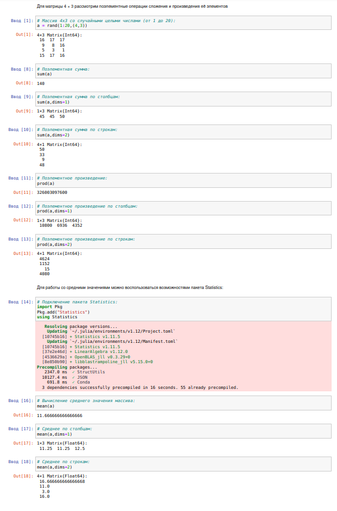{#fig-001 width=70%}

### Транспонирование, след, ранг, определитель и инверсия матрицы

Далее рассмотрим транспонирование, след, ранг, определитель и инверсию матрицы (рис. -@fig-002).

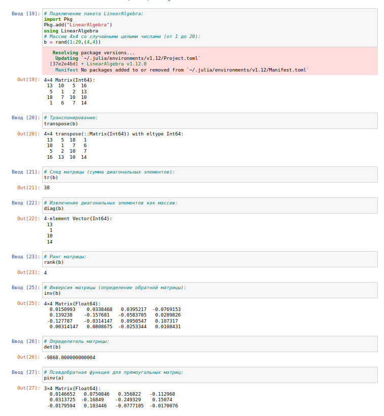{#fig-002 width=70%}

### Вычисление нормы векторов и матриц, повороты, вращения

Тут мы проходимся по примерам вычисления норм векторов и матриц, а также поворотам и вращениям (рис. -@fig-003).

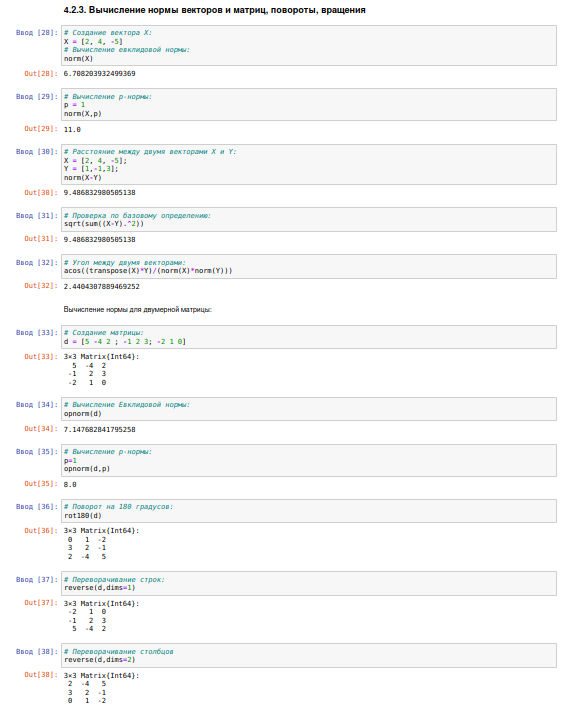{#fig-003 width=70%}

### Матричное умножение, единичная матрица, скалярное произведение

Тут мы проходимся по примерам матричного умножения, единичной матрицы, скалярному произведению (рис. -@fig-004).

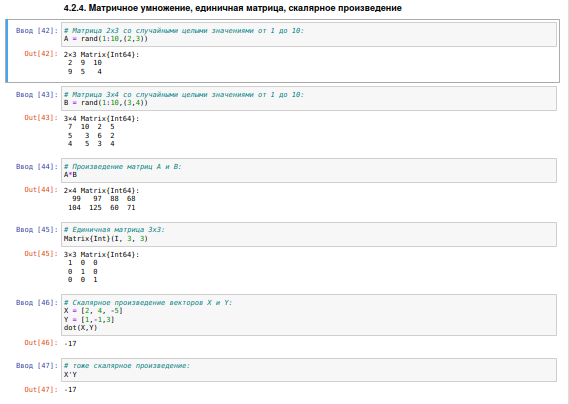{#fig-004 width=70%}

### Факторизация. Специальные матричные структуры

Тут мы проходимся по примера факторизации, а также по специальные матричным структурам (рис. -@fig-005, -@fig-006, -@fig-007, -@fig-008, -@fig-009).

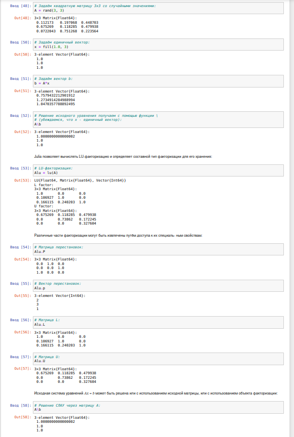{#fig-005 width=70%}

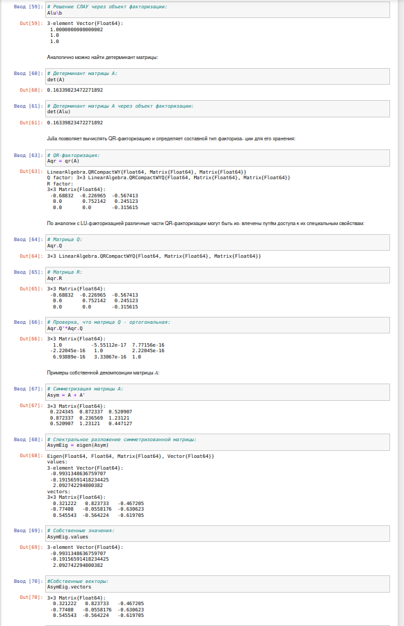{#fig-006 width=70%}

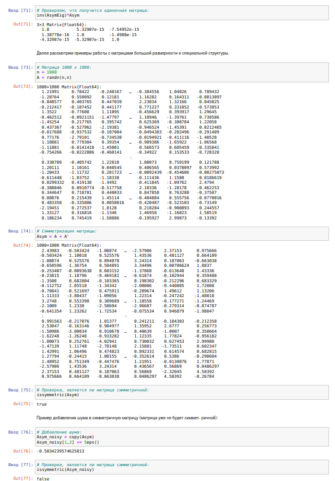{#fig-007 width=70%}

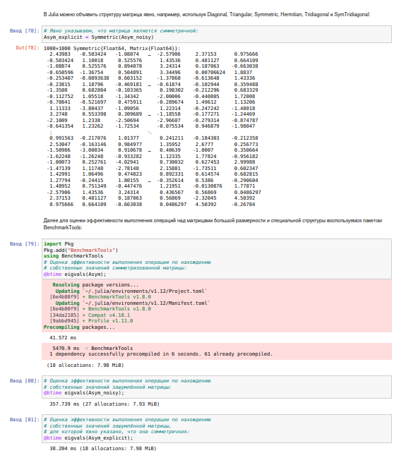{#fig-008 width=70%}

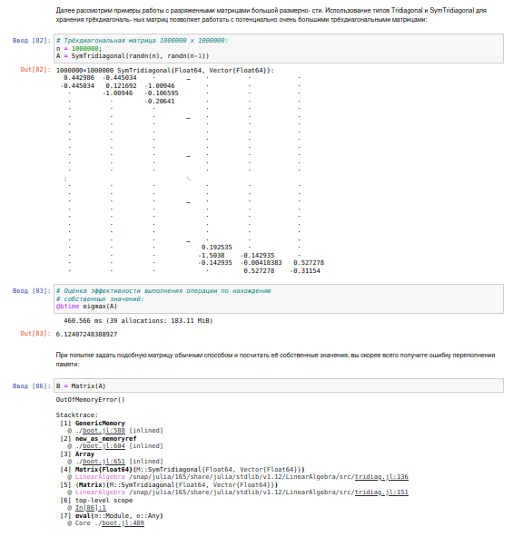{#fig-009 width=70%}

### Общая линейная алгебра

Разберем общую линейную алгебру (рис. -@fig-010).

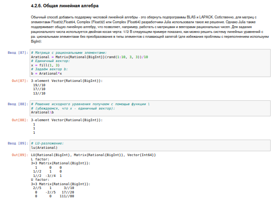{#fig-010 width=70%}

## Задания для самостоятельного выполнения

#### Задание №1

Задайте вектор ```v```. Умножьте вектор ```v``` скалярно сам на себя и сохраните результат в ```dot_v```

Умножьте ```v``` матрично на себя (внешнее произведение), присвоив результат переменной ```outer_v```

Выполнили задание №1 ([рис. @fig-011])

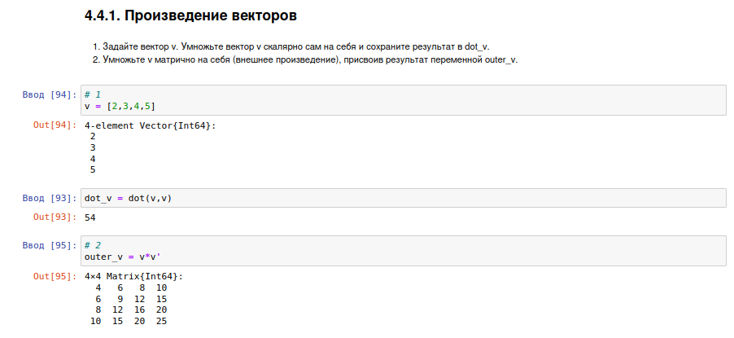{#fig-011 width=70%}

### Системы линейных уравнений

#### Задание №2

Решить СЛАУ с двумя неизвестными.

a) $\begin{cases} x + y = 2, \\ x - y = 3. \end{cases}$

b) $\begin{cases} x + y = 2, \\ 2x + 2y = 4. \end{cases}$

c) $\begin{cases} x + y = 2, \\ 2x + 2y = 5. \end{cases}$

d) $\begin{cases} x + y = 1, \\ 2x + 2y = 2, \\ 3x + 3y = 3. \end{cases}$

e) $\begin{cases} x + y = 2, \\ 2x + y = 1, \\ x - y = 3. \end{cases}$

f) $\begin{cases} x + y = 2, \\ 2x + y = 1, \\ 3x + 2y = 3. \end{cases}$

Выполнили задание №2 ([рис. @fig-012])

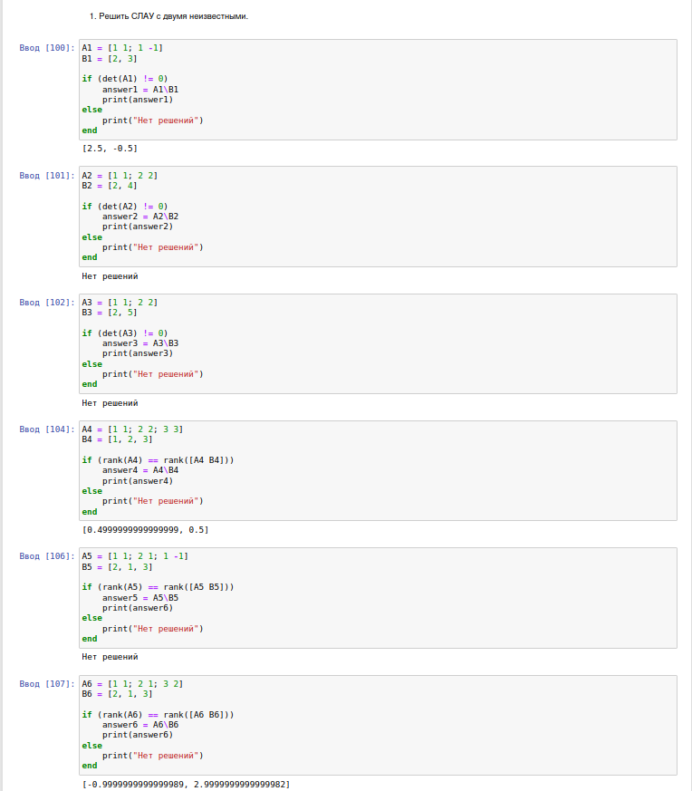{#fig-012 width=70%}

Решить СЛАУ с тремя неизвестными.

a) $\begin{cases} x + y + z = 2, \\ x - y - 2z = 3. \end{cases}$

b) $\begin{cases} x + y + z = 2, \\ 2x + 2y - 3z = 4, \\ 3x + y + z = 1. \end{cases}$

c) $\begin{cases} x + y + z = 1, \\ x + y + 2z = 0, \\ 2x + 2y + 3z = 1. \end{cases}$

d) $\begin{cases} x + y + z = 1, \\ x + y + 2z = 0, \\ 2x + 2y + 3z = 0. \end{cases}$

Выполнили задание №2 ([рис. @fig-013])

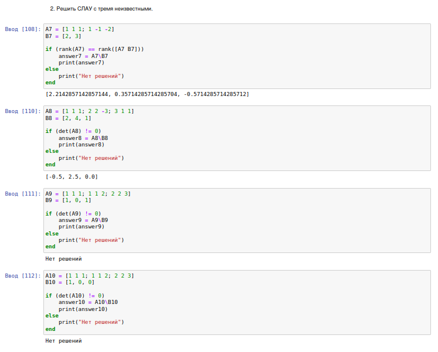{#fig-013 width=70%}

### Операции с матрицами

#### Задание №3

Приведите приведённые ниже матрицы к диагональному виду

a) $\begin{pmatrix} 1 & -2 \\ -2 & 1 \end{pmatrix}$

b) $\begin{pmatrix} 1 & -2 \\ -2 & 3 \end{pmatrix}$

c) $\begin{pmatrix} 1 & -2 & 0 \\ -2 & 1 & 2 \\ 0 & 2 & 0 \end{pmatrix}$

Выполнили задание №3 ([рис. @fig-014])

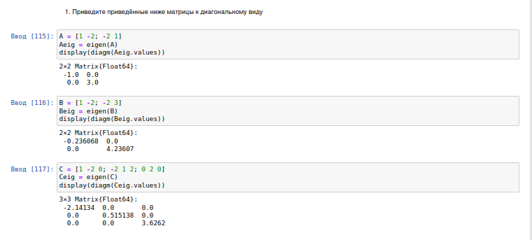{#fig-014 width=70%}

Вычислите

a) $\begin{pmatrix} 1 & -2 \\ -2 & 1 \end{pmatrix}^{10}$

b) $\sqrt{\begin{pmatrix} 5 & -2 \\ -2 & 5 \end{pmatrix}}$

c) $\sqrt[3]{\begin{pmatrix} 1 & -2 \\ -2 & 1 \end{pmatrix}}$

d) $\sqrt{\begin{pmatrix} 1 & 2 \\ 2 & 3 \end{pmatrix}}$

Выполнили задание №3 ([рис. @fig-015])

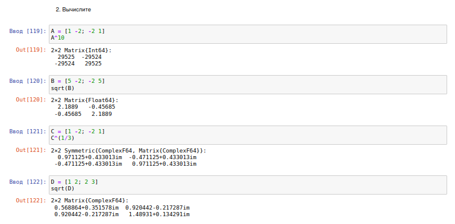{#fig-015 width=70%}

Найдите собственные значения матрицы $A$, если

$$A = \begin{pmatrix} 140 & 97 & 74 & 168 & 131 \\ 97 & 106 & 89 & 131 & 36 \\ 74 & 89 & 152 & 144 & 71 \\ 168 & 131 & 144 & 54 & 142 \\ 131 & 36 & 71 & 142 & 36 \end{pmatrix}.$$

Создайте диагональную матрицу из собственных значений матрицы $A$. Создайте нижнедиагональную матрицу из матрица $A$. Оцените эффективность выполняемых операций

Выполнили задание №3 ([рис. @fig-016])

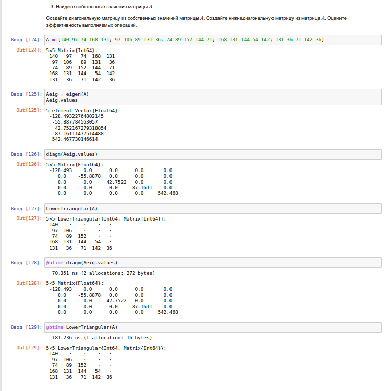{#fig-016 width=70%}

### Линейные модели экономики

Линейная модель экономики может быть записана как СЛАУ $$x - Ax = y$$, где элементы матрицы $A$ и столбца $y$ - неотрицательные числа. По своему смыслу в экономике элементы матрицы $A$ и столбцов $x,y$ не могут быть отрицательными числами

#### Задание №4

Матрица $A$ называется продуктивной, если решение $x$ системы при любой неотрицательной правой части $y$ имеет только неотрицательные элементы $x_i$. Используя это определение, проверьте, являются ли матрицы продуктивными.

a) $\begin{pmatrix} 1 & 2 \\ 3 & 4 \end{pmatrix}$

b) $\frac{1}{2} \begin{pmatrix} 1 & 2 \\ 3 & 4 \end{pmatrix}$

c) $\frac{1}{10} \begin{pmatrix} 1 & 2 \\ 3 & 4 \end{pmatrix}$

Выполнили задание №4 ([рис. @fig-017])

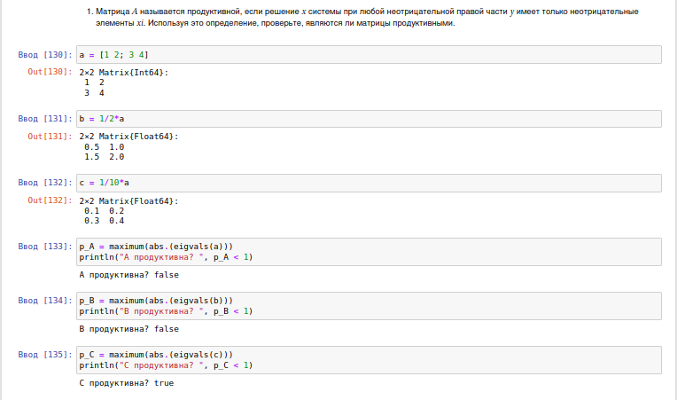{#fig-017 width=70%}

Критерий продуктивности: матрица $A$ является продуктивной тогда и только тогда, когда все элементы матрицы $$(E - A)^{-1}$$ являются неотрицательными числами. Используя этот критерий, проверьте, являются ли матрицы продуктивными

a) $\begin{pmatrix} 1 & 2 \\ 3 & 1 \end{pmatrix}$

b) $\frac{1}{2} \begin{pmatrix} 1 & 2 \\ 3 & 1 \end{pmatrix}$

c) $\frac{1}{10} \begin{pmatrix} 1 & 2 \\ 3 & 1 \end{pmatrix}$

Выполнили задание №4 ([рис. @fig-018])

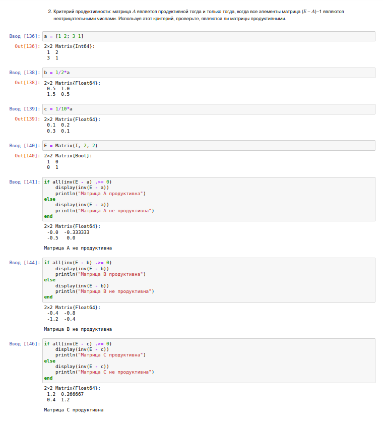{#fig-018 width=70%}

Спектральный критерий продуктивности: матрица $A$ является продуктивной тогда и только тогда, когда все её собственные значения по модулю меньше 1. Используя этот критерий, проверьте, являются ли матрицы продуктивными

a) $\begin{pmatrix} 1 & 2 \\ 3 & 1 \end{pmatrix}$

b) $\frac{1}{2} \begin{pmatrix} 1 & 2 \\ 3 & 1 \end{pmatrix}$

c) $\frac{1}{10} \begin{pmatrix} 1 & 2 \\ 3 & 1 \end{pmatrix}$

d) $\begin{pmatrix} 0.1 & 0.2 & 0.3 \\ 0 & 0.1 & 0.2 \\ 0 & 0.1 & 0.3 \end{pmatrix}$

Выполнили задание №4 ([рис. @fig-019])

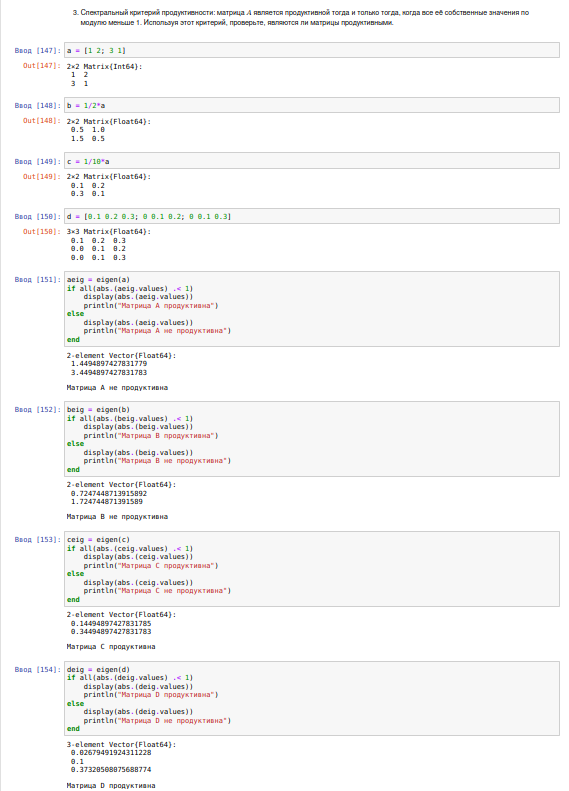{#fig-019 width=70%}

# Заключение

В ходе выполнения лабораторной работы мы изучили возможности специальных пакетов Julia ля выполнения и оценки эффективности операций над объектами линейной алгебры.

# Список литературы {.unnumbered}

::: {#refs}
:::


