---
## Author
author:
  name: Стрижов Дмитрий Павлович
  degrees: student
  orcid: 0000-0002-0877-7063
  email: 1132236054@rudn.ru
  affiliation:
    - name: Российский университет дружбы народов
      country: Российская Федерация
      postal-code: 117198
      city: Москва
      address: ул. Миклухо-Маклая, д. 6
      
## Title
title: "Отчет по лабораторной работе №6"
subtitle: "Компьютерный практикум по статистическому анализу данных"
license: CC BY
date: today
date-format: "2026-11-20" # Example: 2025-09-06
---

# Информация

## Докладчик

:::::::::::::: {.columns align=center}
::: {.column width="70%"}

  * Стрижов Дмитрий Павлович
  * студент Факультета физико-математических и естественных наук
  * Российский университет дружбы народов им. П. Лумумбы
  * [1132236054@rudn.ru](mailto:1132236054@rudn.ru)

:::
::: {.column width="30%"}

:::
::::::::::::::

# Вводная часть

## Цели и задачи

- Цель:
    - Основной целью работы является освоение специализированных пакетов для решения задач в непрерывном и дискретном времени.
- Задачи:
     - Используя Jupyter Lab, повторите примеры из раздела 6.2.
     - Выполните задания для самостоятельной работы (раздел 6.4).

# Выполнение лабораторной работы

# Раздел 6.2

## Решение обыкновенных дифференциальных уравнений

Реализуем модель экспоненциального роста (рис. -@fig-001).

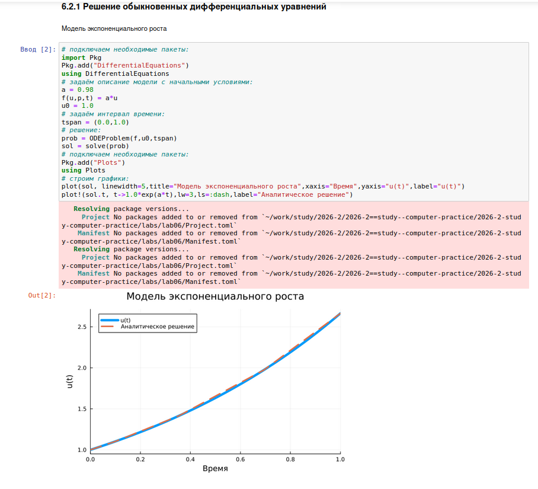{#fig-001 width=70%}

## Решение обыкновенных дифференциальных уравнений

Сравним её с аналитическим решением (рис. -@fig-002).

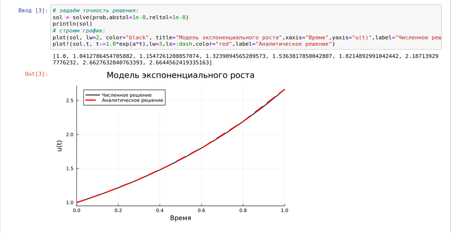{#fig-002 width=70%}

## Решение обыкновенных дифференциальных уравнений

Реализуем систему Лоренца (рис. -@fig-003, -@fig-004).

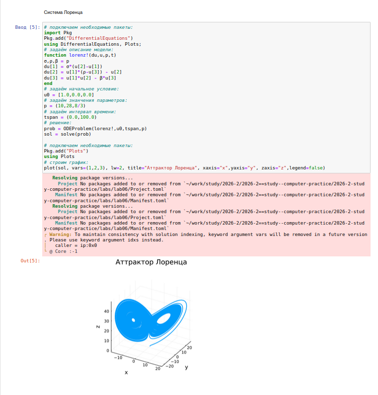{#fig-003 width=70%}

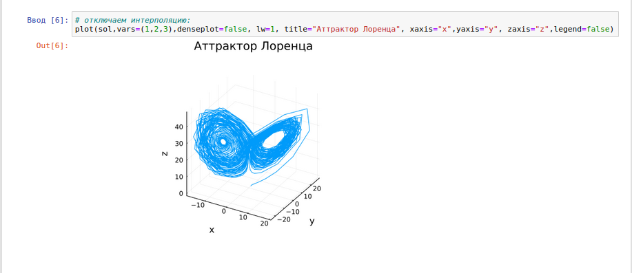{#fig-004 width=70%}

## Модель Лотки–Вольтерры

Реализуем модель Лотки–Вольтерры (рис. -@fig-005).

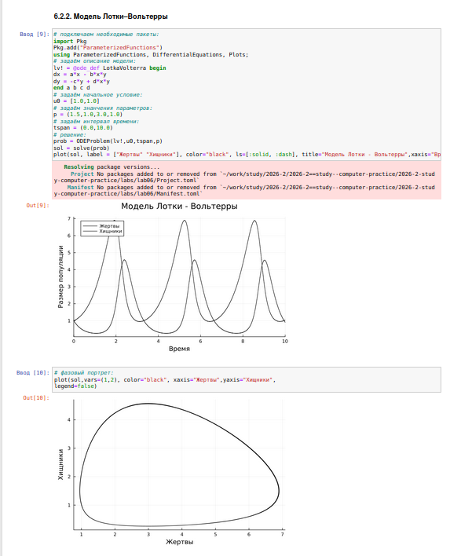{#fig-005 width=70%}

## Задания для самостоятельного выполнения

## Задание №1

Реализовать и проанализировать модель роста численности изолированной популяции (модель Мальтуса): $$\dot{x} = ax, \quad a = b - c,$$

где $x(t)$ - численность изолированной популяции в момент времени $t$, $a$ - коэффициент роста популяции, $b$ - коэффициент рождаемости, $c$ -  коэффициент смертности. Начальные данные и параметры задать самостоятельно и пояснить их выбор. Построить соответствующие графики (в том числе с анимацией)

## Задание №1

Выполнили задание №1 ([рис. @fig-006]), ([рис. @fig-007])

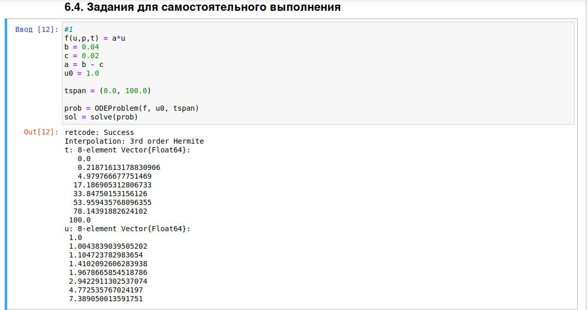{#fig-006 width=70%}

## Задание №1

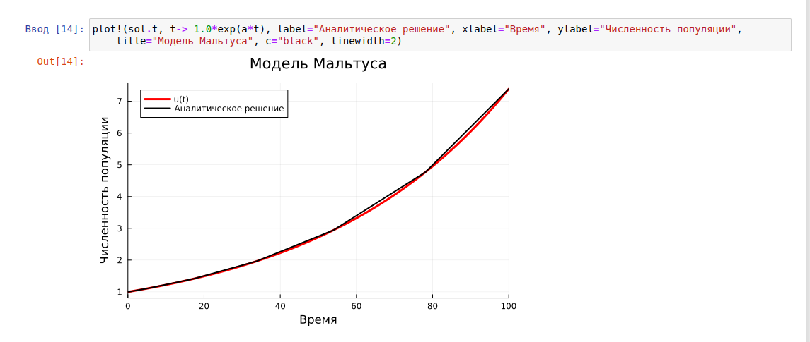{#fig-007 width=70%}

## Задание №2

Реализовать и проанализировать логистическую модель роста популяции, заданную уравнением: $$\dot{x} = rx\left(1 - \frac{x}{k}\right), \quad r > 0, \quad k > 0,$$  

где $r$ - коэффициент роста популяции, $k$ - потенциальная ёмкость экологической системы (предельное значение численности популяции). Начальные данные и параметры задать самостоятельно и пояснить их выбор. Построить соответствующие графики (в том числе с анимацией)

## Задание №2

Выполнили задание №2 ([рис. @fig-008]), ([рис. @fig-009])

## Задание №2

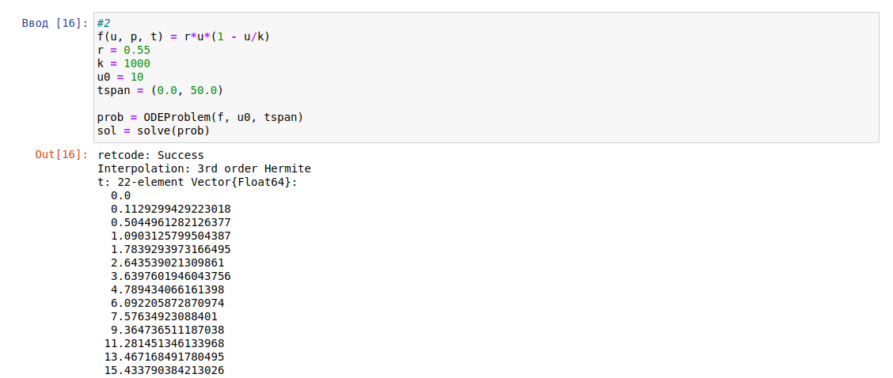{#fig-008 width=70%}

## Задание №2

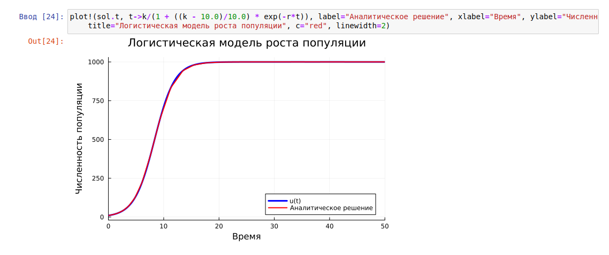{#fig-009 width=70%}

## Задание №3

Реализовать и проанализировать модель эпидемии Кермака–Маккендрика (SIR-модель): 

$$
\begin{cases}
\dot{s} = -\beta i s, \\
\dot{i} = \beta i s - \nu i, \\
\dot{r} = \nu i,
\end{cases}
$$

где $s(t)$ - численность восприимчивых к болезни индивидов в момент времени $t$, $i(t)$ - численность инфицированных индивидов в момент времени $t$, $r(t)$ - численность переболевших индивидов в момент времени $t$, $\beta$ - коэффициент интенсивности контактов индивидов с последующим инфицированием, $v$ - коэффициент интенсивности выздоровления инфицированных индивидов. Численность популяции считается постоянной, т.е. $\dot{s} + \dot{i} + \dot{r} = 0$. Начальные данные и параметры задать самостоятельно и пояснить их выбор. Построить соответствующие графики (в том числе с анимацией)

## Задание №3

Выполнили задание №3 ([рис. @fig-010]), ([рис. @fig-011])

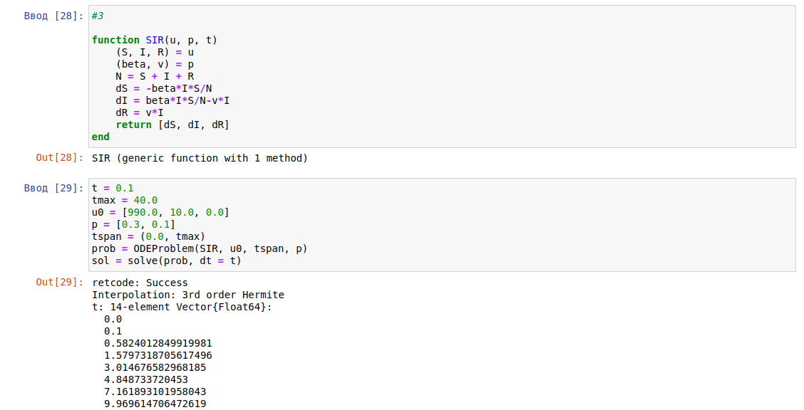{#fig-010 width=70%}

## Задание №3

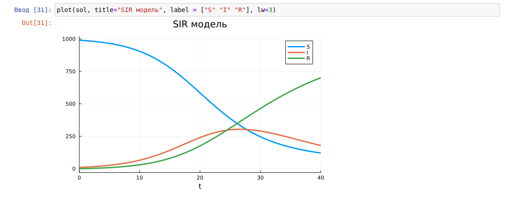{#fig-011 width=70%}

## Задание №4

Как расширение модели SIR (Susceptible-Infected-Removed) по результатом эпидемии испанки была предложена модель SEIR (Susceptible-Exposed-Infected-Removed): 

$$
\begin{cases}
\dot{s}(t) = -\frac{\beta}{N} s(t) i(t), \\
\dot{e}(t) = \frac{\beta}{N} s(t) i(t) - \delta e(t), \\
\dot{i}(t) = \delta e(t) - \gamma i(t), \\
\dot{r}(t) = \gamma i(t)
\end{cases}
$$

## Задание №4

Размер популяции сохраняется: $$s(t) + e(t) + i(t) + r(t) = N$$

Исследуйте, сравните с SIR.

## Задание №4

Выполнили задание №4 ([рис. @fig-012]), ([рис. @fig-013])

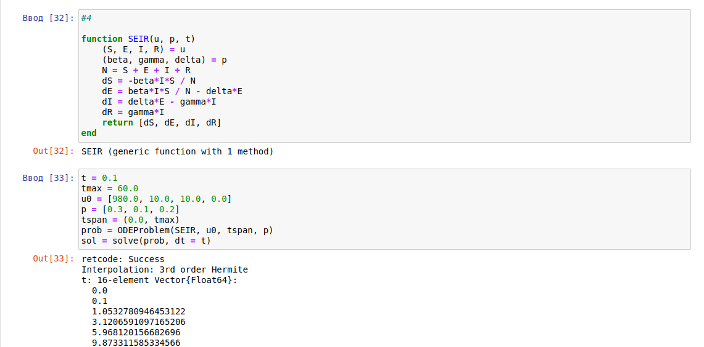{#fig-012 width=70%}

## Задание №4

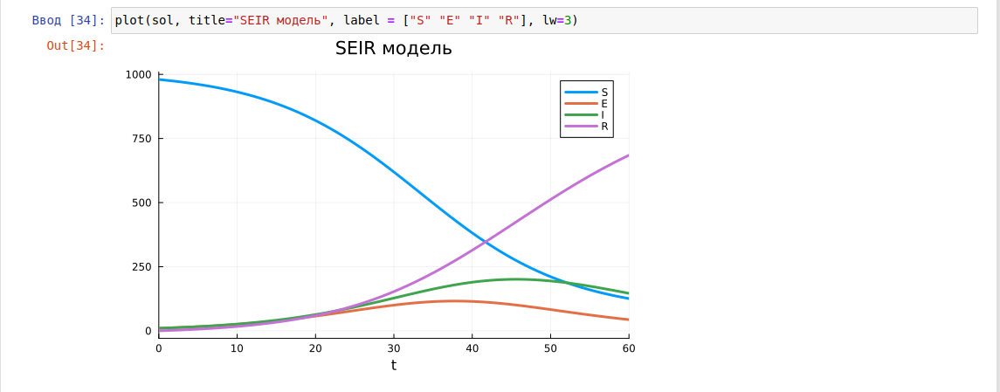{#fig-013 width=70%}

## Задание №5

Для дискретной модели Лотки–Вольтерры: 

$$
\begin{cases}
X_1(t+1) = aX_1(t)(1 - X_1(t)) - X_1(t)X_2(t), \\
X_2(t+1) = -cX_2(t) + dX_1(t)X_2(t)
\end{cases}
$$

с начальными данными $a = 2, c = 1, d = 5$ найдите точку равновесия. Получите и сравните аналитическое и численное решения. Численное решение изобразите на фазовом портрете

## Задание №5

Выполнили задание №5 ([рис. @fig-014])

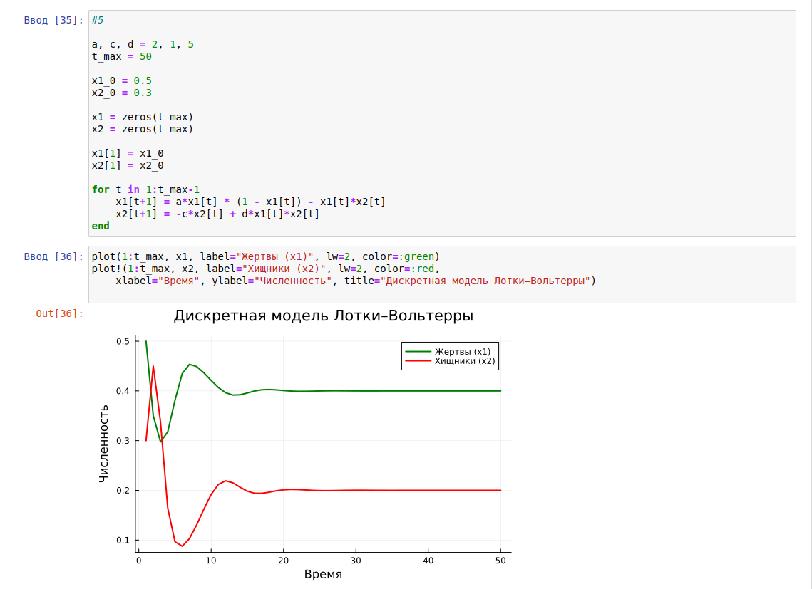{#fig-014 width=70%}

## Задание №6

Реализовать на языке Julia модель отбора на основе конкурентных отношений: 

$$
\begin{cases}
\dot{x} = \alpha x - \beta xy, \\
\dot{y} = \alpha y - \beta xy
\end{cases}
$$

## Задание №6

Начальные данные и параметры задать самостоятельно и пояснить их выбор. Построить соответствующие графики (в том числе с анимацией) и фазовый портрет

Выполнили задание №6 ([рис. @fig-015]), ([рис. @fig-016])

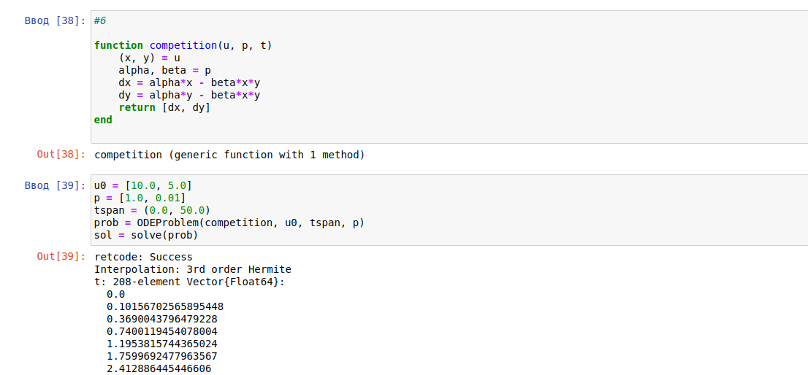{#fig-015 width=70%}

## Задание №6

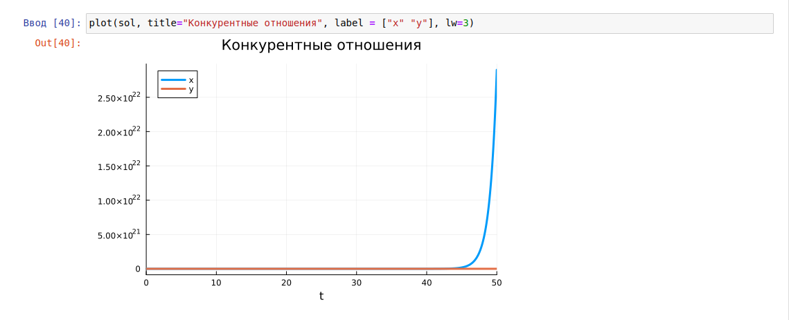{#fig-016 width=70%}

## Задание №7

Реализовать на языке Julia модель консервативного гармонического осциллятора $$\ddot{x} + \omega_0^2 x = 0, \quad x(t_0) = x_0, \quad \dot{x}(t_0) = y_0,$$

где $\omega_0$ - циклическая частота. Начальные параметры подобрать самостоятельно, выбор пояснить. Построить соответствующие графики (в том числе с анимацией) и фазовый портрет

## Задание №7

Выполнили задание №7 ([рис. @fig-017]), ([рис. @fig-018])

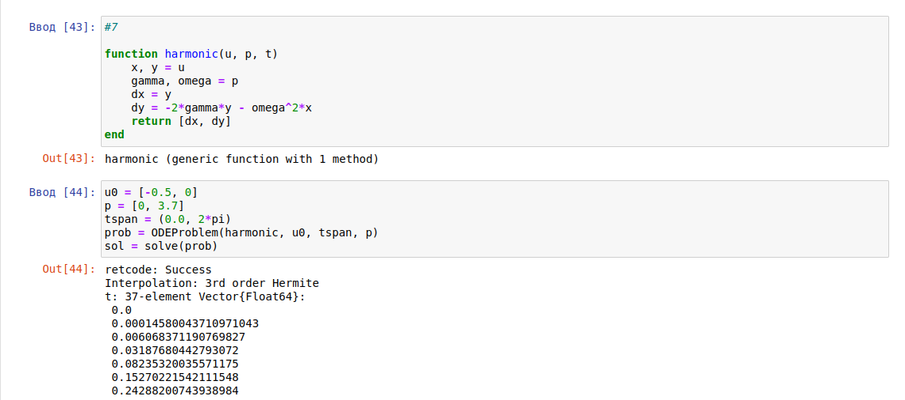{#fig-017 width=70%}

## Задание №7

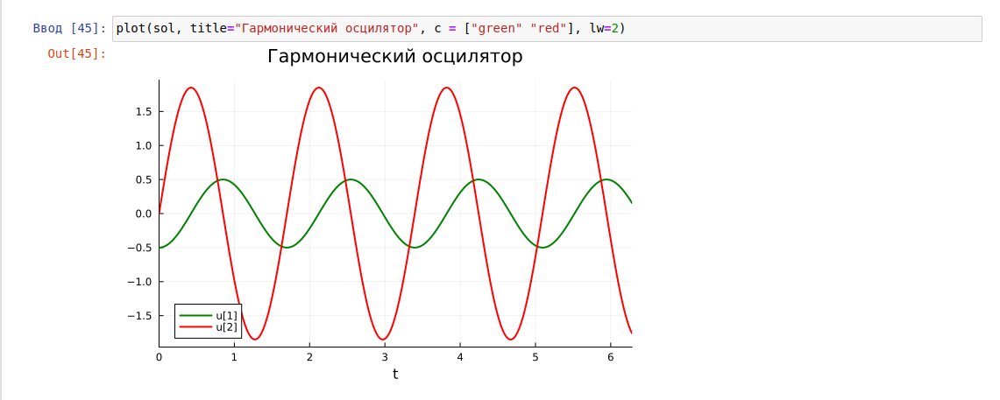{#fig-018 width=70%}

## Задание №8

Реализовать на языке Julia модель свободных колебаний гармонического осциллятора $$\ddot{x} + 2\gamma \dot{x} + \omega_0^2 x = 0, \quad x(t_0) = x_0, \quad \dot{x}(t_0) = y_0,$$

где $\omega_0$ - циклическая частота, $\gamma$ - параметр, характеризующий потери энергии.
Начальные параметры подобрать самостоятельно, выбор пояснить. Построить соответствующие графики (в том числе с анимацией) и фазовый портрет

## Задание №8

Выполнили задание №8 ([рис. @fig-019]), ([рис. @fig-020])

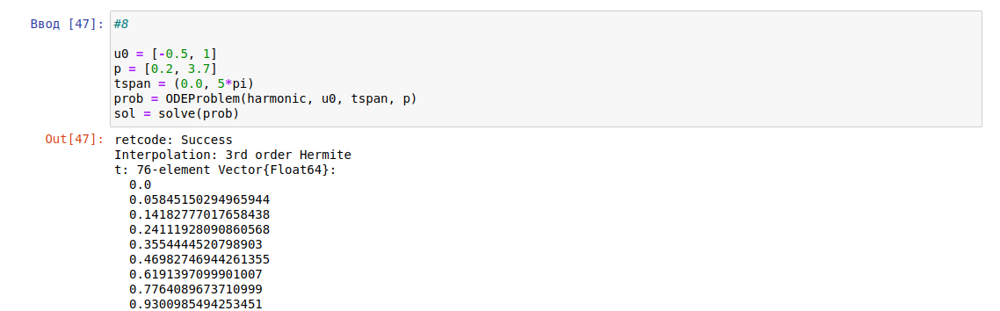{#fig-019 width=70%}

## Задание №8

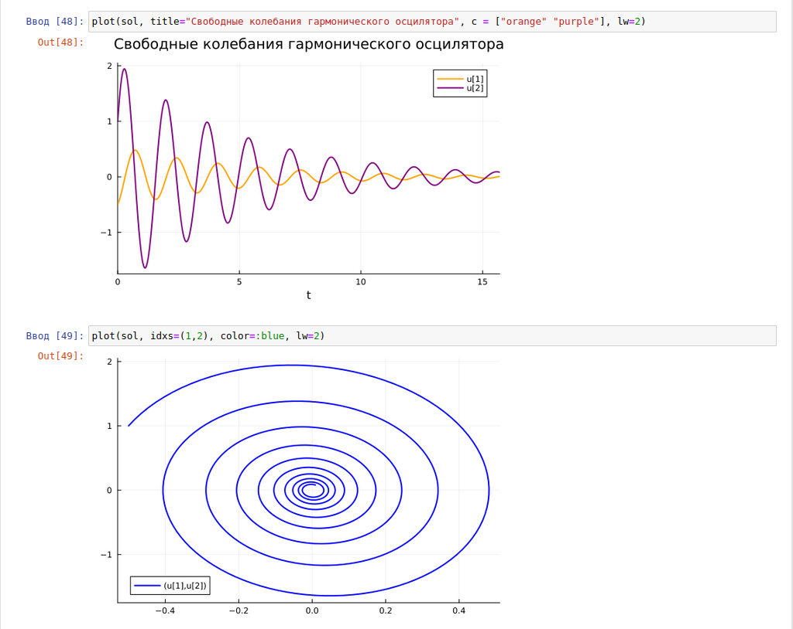{#fig-020 width=70%}

# Заключение

Были освоены специализированные пакеты для решения задач в непрерывном и дискретном времени

# Список литературы {.unnumbered}

